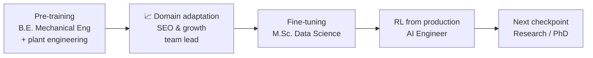

<!-- ───────────────────────────── HEADER ───────────────────────────── -->
<div align="center">


<br/>


<br/><br/>

<picture>
  <source media="(prefers-color-scheme: dark)" srcset="assets/training-run-dark.svg" />
  <source media="(prefers-color-scheme: light)" srcset="assets/training-run-light.svg" />
  
</picture>

</div>

---

## Quick start

```python
from transformers import AutoHuman

zayan = AutoHuman.from_pretrained("zayanahmed23/ai-engineer-v27")

zayan.generate(
    prompt="Ship an LLM feature, then prove it works.",
    eval_first=True,          # writes the eval harness before the prompt
    explain_failures=True,    # asks *why* the model was wrong, not just *how often*
)
# >>> "Done. Here's the confusion matrix, the failure modes, and the fix."
```

---

## Model details

| Field | Value |
|---|---|
| **Developed by** | Zayan Ahmed |
| **Model type** | AI x ML Engineer × Researcher (hybrid, production-tested) |
| **Currently deployed at** | AI Engineer in Karachi 🇵🇰 |
| **Base model** | B.E. Mechanical Engineering, NED University (2017–2021) |
| **Fine-tuned on** | M.Sc. Data Science, NED University (2023–2025) · GPA 3.6 / 4.0 |
| **Auxiliary heads** | 4+ years of SEO & growth (led a 20+ person SEO team) |
| **Primary languages** | Python, SQL, English, Urdu |
| **Research focus** | Model evaluation & generalization · interpretability / XAI · failure modes & spurious correlations |

> **Model description.** A practitioner who builds ML systems end-to-end and then tries to break them. Comfortable going from a
> raw dataset to a deployed model, but most interested in the questions that come after the accuracy number: *does it generalize,
> what is it actually looking at, and where does it fail?*

---

## Training procedure



| Stage | Data | What it learned |
|---|---|---|
| **Pre-training** · 2017–2023 | B.E. Mechanical Eng · Executive Engineer, services & projects at a denim mill · maintenance trainee in textiles | Systems thinking, root-cause analysis, keeping real machines running |
| **Domain adaptation** · 2017–2025 | Freelance SEO → Ads Manager → **SEO Team Lead** (20+ executives, 200+ client projects) | Search intent, experimentation, measuring what matters, leading people |
| **Fine-tuning** · 2023–2025 | **M.Sc. Data Science**, NED University | Statistics, ML, deep learning, NLP, computer vision |
| **RL from production** · 2025– | Associate ML Engineer → **AI Engineer** | Shipping models that real users depend on |

---

## Capabilities

<p align="center">
  <br/>
  <br/>
  
</p>

| Domain | Toolkit |
|---|---|
| **LLMs & agents** | Prompt + schema design, multi-agent pipelines, structured outputs, LLM-as-judge, safety classifiers, MCP servers |
| **Deep learning** | PyTorch, TensorFlow/Keras, transfer learning, CNNs (ResNet, U-Net), custom losses |
| **Audio** | Keyword spotting / wake-word detection for on-device inference |
| **Computer vision** | Classification, semantic segmentation, weak / sparse supervision, remote sensing, medical imaging |
| **NLP** | Intent classification, TF-IDF / embedding semantic search, text classification, LLM-based content moderation |
| **Evaluation & XAI** | Grad-CAM, deletion-based faithfulness tests, ablations, calibration, error analysis |
| **Classical ML & data** | scikit-learn, pandas, NumPy, SQL, statistical testing, churn & tabular modelling |
| **Shipping** | FastAPI, Flask, Streamlit, Docker, Git/GitHub Actions, Cloudflare Workers |

---

## Evaluation results

Real numbers from public repos. Click through for code, reports and caveats.

| Benchmark (repo) | Task | Result |
|---|---|---|
| [**ds-eval-pipeline**](https://github.com/zayanahmed23/ds-eval-pipeline) | Multi-agent grader for DS take-home notebooks: leakage, rigor, business narrative | Split-view design improved code-score **calibration by 33%** |
| [**medical-image-classification-xai**](https://github.com/zayanahmed23/medical-image-classification-xai) | Pneumonia detection (ResNet-18) + Grad-CAM faithfulness | **AUROC 0.95** · Masking salient regions dropped false-positive confidence **25–67%**, exposing spurious features |
| [**landvisor-segmentation**](https://github.com/zayanahmed23/landvisor-segmentation) | U-Net segmentation of satellite imagery from **sparse point labels** | Custom partial cross-entropy loss + ablation over 1 / 5 / 10 / 50 points |
| [**customer-support-bot**](https://github.com/zayanahmed23/customer-support-bot) | NLP support assistant, no third-party bot APIs | 8-intent classifier + semantic FAQ fallback + multi-turn memory |
| [**seo-mcp-server**](https://github.com/zayanahmed23/seo-mcp-server) | MCP server that gives LLM agents SEO tooling | Where the ML and search halves of the training data meet |

---

## Production deployments

Shipped at work (client names withheld):

- **On-device wake-word model** for a healthcare smartwatch: always-on keyword spotting under tight compute and battery budgets.
- **LLM safety evaluator** for a fitness app's member messaging: scores messages in real time and blocks grooming attempts before they're delivered. *Sole engineer.*
- **AI products platform**: built and deployed the backend models, and guide the team that markets them.

---

## Intended use

**Well-suited for**
- Funded **PhD / research positions**: evaluation, interpretability, robustness
- **Research & open-source collaborations** on model failure modes and spurious correlations
- **Freelance & part-time AI engineering**: LLM apps, agents, eval pipelines, CV/NLP models

**Out of scope**
- Shipping a model without an eval set
- Claiming SOTA from a single random seed

---

## Known limitations & biases

- Strong prior toward writing the eval harness *before* the model. Unstable under "just make the demo work".
- Will ask "what is the model actually looking at?" in meetings.
- Trained mainly on CPU-constrained hardware, so heavily optimized for efficiency. Unlocks more capabilities when given a GPU.
- Carries a residual mechanical-engineering bias: believes every system has a maintenance schedule, models included.

---

## Inference endpoints

<p align="center">
  <a href="mailto:zayanahmed222@gmail.com"></a>
  <a href="https://www.linkedin.com/in/zayan-ahmed-1623b71b4"></a>
</p>

### Citation

```bibtex
@misc{ahmed2026zayan,
  title        = {zayan-ahmed/ai-engineer-v27: Building Models That Fail Gracefully},
  author       = {Ahmed, Zayan},
  year         = {2026},
  howpublished = {\url{https://github.com/zayanahmed23}},
  note         = {Open to PhD positions, research collaborations and AI engineering work}
}
```

---

<div align="center">
<sub>🧠 model card last updated October 2026 · <code>model.eval()</code> mode: always on</sub>
</div>
